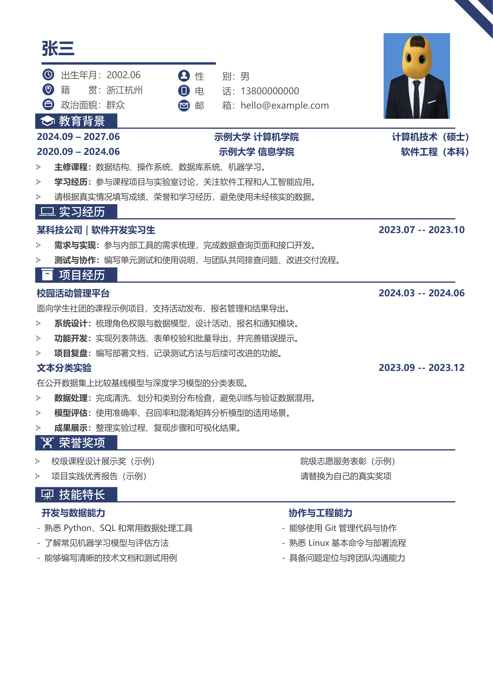

# 中文简历 Overleaf 模板

一页式 A4 中文简历模板，使用 XeLaTeX 编译。正文是可编辑的 LaTeX，包含教育背景、实习经历、项目经历、荣誉奖项和技能特长。仓库里的姓名、联系方式、学校、公司与经历均为虚构示例。



上图为用虚构示例制作的版式示意图；实际换行和位置以 XeLaTeX 编译结果为准。

## 在 Overleaf 中使用

1. 下载本仓库的 ZIP，在 Overleaf 选择 **New Project → Upload Project**。
2. 在项目设置中将 **Compiler** 设为 **XeLaTeX**，主文件选择 `main.tex`。
3. 编辑 `content.tex`，点击 **Recompile**。

本地若安装了 TeX Live，可在仓库目录运行 `latexmk`；`latexmkrc` 已设置 XeLaTeX。

## 文件说明

| 文件 | 用途 |
| --- | --- |
| `content.tex` | 示例资料和简历正文，日常主要编辑这里 |
| `resume.sty` | 颜色、字体、图标、边距和排版命令 |
| `main.tex` | 编译入口 |
| `fonts/` | 思源黑体 CN Medium，按随附的 SIL OFL 许可使用 |
| `assets/preview.png` | 虚构示例的版式示意图 |

照片区域默认是绘制的占位框。需要照片时，可在自己的副本中修改 `resume.sty` 的 `\ResumePhotoGraphic` 定义。公开自己的简历仓库前，请检查源文件、图片、编译产物和 PDF 元数据中的个人信息。

## 常用命令

```tex
\ResumeHeader{姓名}{出生年月}{籍贯}{政治面貌}{性别}{电话}{邮箱}
\ResumeSection{2}{项目经历}
\Entry{项目名称}{2024.03 -{}- 2024.06}
\Description{项目背景和目标。}
\begin{resumeitems}
  \Point{个人工作：}{说明你具体做了什么。}
\end{resumeitems}
```

`\ResumeSection` 的编号依次为：`0` 教育、`1` 实习、`2` 项目、`3` 奖项、`4` 技能。奖项使用 `\AwardRow{左列}{右列}`；技能使用 `\SkillHead{左标题}{右标题}` 和 `\SkillRow{左内容}{右内容}`。百分号、下划线和 `&` 分别写作 `\%`、`\_`、`\&`。

示例按单页设计，替换为较长内容后可能分页。建议先精简文字，再调整 `resume.sty` 的间距或字号。

## 许可

模板源码采用 [MIT License](LICENSE)。`fonts/SourceHanSansCN-Medium.otf` 采用随附的 [SIL Open Font License](fonts/SourceHanSans-LICENSE.txt)。
